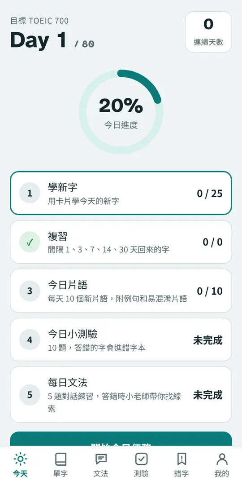
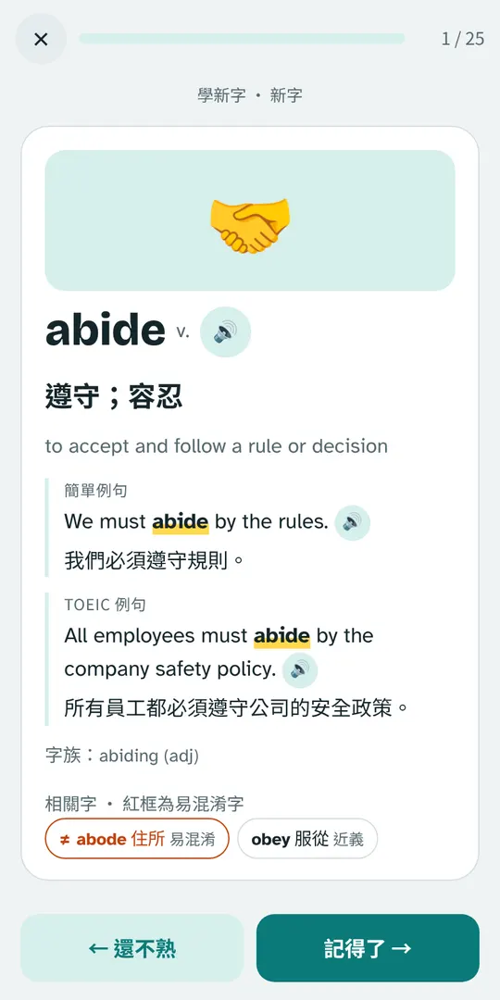
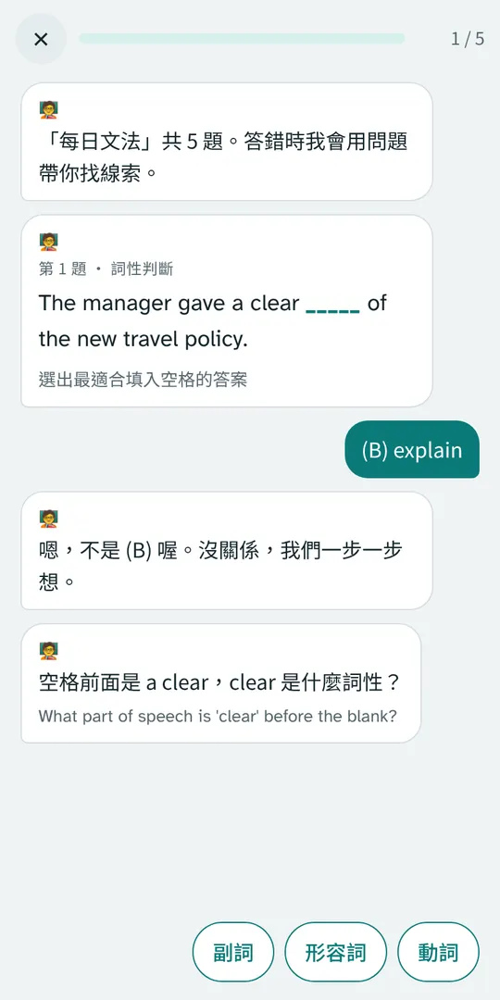
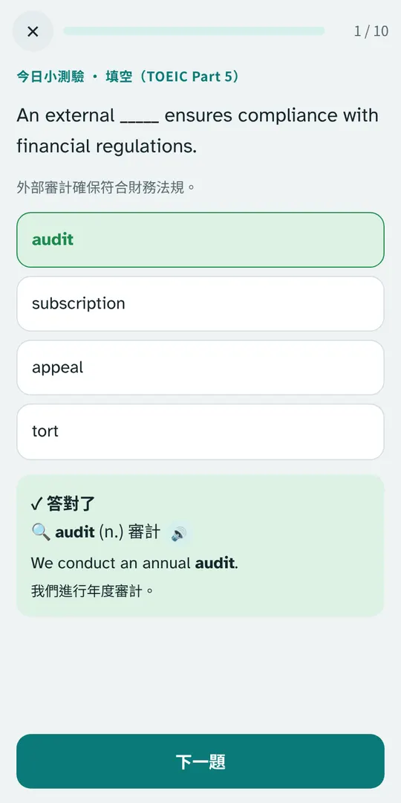
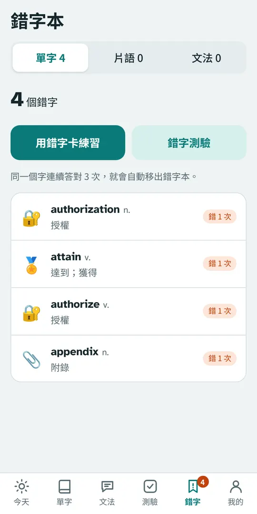
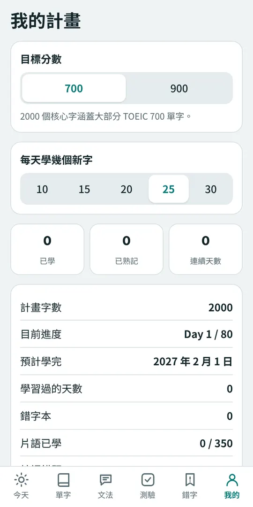

# TOEIC 單字 App / TOEIC Learning

免費的 TOEIC 700／900 學習 App：3000 個單字、500 個片語、300 題對話式文法練習，每天有任務、答錯自動進錯字本，不用帳號，沒網路也能用。
A free TOEIC 700 / 900 trainer: words, phrases and grammar with a daily plan, spaced review and a mistakes deck. No account, works offline. Explanations are in English and Traditional Chinese (繁體中文).

**介紹頁 Project page：<https://toeic-learning.hoya-chen.workers.dev/>**　·　**開始學習 Open the app：<https://toeic-learning.hoya-chen.workers.dev/app/>**　·　**Android APK：[下載 Download](https://github.com/hoya-chen/toeic-learning/releases/latest/download/toeic-vocab.apk)**

| 今天 Today | 單字卡 Cards | 文法小老師 Grammar tutor |
|---|---|---|
|  |  |  |
| **測驗 Quiz** | **錯字本 Mistakes** | **我的計畫 My plan** |
|  |  |  |

## How learners use it / 怎麼使用

| Way 方式 | Link 連結 | For 適合 |
|---|---|---|
| Project page 介紹頁 | https://toeic-learning.hoya-chen.workers.dev/ (backup 備用: https://hoya-chen.github.io/toeic-learning/) | What the app does, screenshots, all links 功能說明、截圖與所有連結 |
| Android app (APK) | https://github.com/hoya-chen/toeic-learning/releases/latest/download/toeic-vocab.apk | Android phones, works offline 安卓手機，可離線使用 |
| Phone web app 手機網頁版 | https://toeic-learning.hoya-chen.workers.dev/app/ (backup 備用: https://hoya-chen.github.io/toeic-learning/app/) | iPhone and any phone; "Add to Home Screen" to use it like an app 任何手機，可「加到主畫面」 |
| Classic page 舊版單字卡網頁 | https://toeic-learning.hoya-chen.workers.dev/classic/ | Computer browser, many cards at once 電腦瀏覽器，一次看很多張卡 |

**Install the Android app 安裝 Android App**

1. Open the APK link above on the phone and download `toeic-vocab.apk`. 用手機打開上面的 APK 連結，下載 `toeic-vocab.apk`。
2. Open the downloaded file. The first time, Android asks to allow installing apps from this source: choose Allow. 打開下載的檔案；第一次安裝時手機會問是否「允許安裝不明來源的應用程式」，選允許。
3. Tap Install, then open "TOEIC 單字". 按安裝，然後打開「TOEIC 單字」。

To update, download the APK again and install it over the old one; progress is kept. 更新時重新下載安裝即可，學習進度會保留。

Progress is saved on each device (no account), so the app, the web app and the original page each keep their own progress. Use Me > Backup progress (我的 > 備份進度) to move progress to another device. 進度存在各自的手機或瀏覽器裡（不需要帳號），App、手機網頁版和原本的網頁進度各自分開；換裝置時可用「我的 > 備份進度」匯出再匯入。

The site in `docs/` is served by Cloudflare Workers and GitHub Pages (branch `main`, folder `/docs`); both update on every merge to `main`. 網站（`docs/` 資料夾）同時放在 Cloudflare 和 GitHub Pages，每次合併到 `main` 都會自動更新。

## What is here

- `docs/index.html` is the project page (介紹頁): what the app does, screenshots (`docs/landing/`), how to install and all links.
- `docs/classic/index.html` (the original web page, moved from the site root; progress is kept because it is the same site) and `vocabulary/flashcards.html` are the classic learner page (single file, no server needed). It has My Plan, Study, Review (spaced repetition), Quiz (6 question types) and Mistakes. Progress is stored in each learner's own browser.
- `vocabulary/all-3000-words.json` is the full word data (field `lvl` is 700 or 900): 2000 core words (10 topics x 200, days 1-80) plus 1000 advanced words (10 topics x 100, days 81-120), 25 words a day.
- `vocabulary/advanced-900-words.json` holds only the 1000 advanced words; `advanced-900-selection.json` lists them with their source list (BSL, NAWL or NGSL).
- `vocabulary/all-2000-words-renumbered.json` is the 700-level core data (2000 words).
- `vocabulary/list-01-*.md` to `list-10-*.md` (and `.json`) are the per-topic lists.
- `vocabulary/study-plan.md` is the 10-week study plan.
- `vocabulary/source-TSL-1.2-wordlist.txt` and `source-BSL-1.2-wordlist.txt` are the word lists the 2000 words were chosen from.
- `vocabulary/all-2000-words-ai-generated-backup.json` is an earlier, AI-chosen 2000-word set kept as a backup.

## Phone app (redesign)

`docs/app/` is a redesigned, phone-first version of the trainer: a bottom tab bar (Today, Words, Grammar, Quiz, Mistakes, Me), a daily task flow (new words, then due reviews, then a 10-question quiz, then 5 grammar questions), swipe cards, a streak and progress backup (export/import). It is an installable offline web app (PWA). With GitHub Pages serving `main` from `/docs`, it is at https://hoya-chen.github.io/toeic-learning/app/ . It uses the same browser storage keys as the earlier page, so progress made there carries over on the same site.

The Grammar tab (文法) covers 20 common TOEIC Part 5/6 grammar topics, 15 questions each (10 at 700 level, 5 at 900 level), in `docs/app/grammar.js`. A built-in chat tutor asks each question; after a wrong answer it asks one or two guiding questions before showing the answer, with bilingual (English / Traditional Chinese) explanations, the rule and everyday examples. It works offline with no AI service. Wrong answers go to the Mistakes tab and leave after 3 correct answers in a row. The questions are machine-generated and re-checked by a second automated pass, so they may contain errors.

Phrases (片語): 500 common TOEIC phrases in `docs/app/phrases.js`: phrasal verbs (look into), prepositional phrases (in charge of) and business expressions (on short notice), 350 at 700 level and 150 at 900 level, grouped by the same 10 topics as the words. Open them from the Words tab with the 單字 / 片語 switch. Each card has English and Traditional Chinese meanings, an everyday example, a TOEIC-style example, related phrases and easily confused phrases. The Today tab adds 10 new phrases a day plus spaced review; quizzes include a fill-in-the-blank with confusable phrases; wrong answers go to the Mistakes tab (片語 section) and are included in the progress backup. The content is machine-generated and re-checked by a second automated pass, so it may contain errors.

## Android app (APK)

`android/` wraps the phone app in `docs/app` in a small Android WebView app: it works offline, speaks words with the phone's text-to-speech, and handles the back button. GitHub Actions (`.github/workflows/android-apk.yml`) builds it on every change. On `main`, once the repository secret `ANDROID_KEYSTORE_BASE64` holds the signing key, each build is published as a release, and the latest APK is always at https://github.com/hoya-chen/toeic-learning/releases/latest/download/toeic-vocab.apk . Without the secret the workflow only builds a test APK (download it from the run's artifacts). The signing key is kept outside the repository; every release must use the same key so updates install over the old version and keep learners' progress.

## How the 2000 words were chosen

All 1,249 words of the TOEIC Service List (TSL 1.2) plus 751 words from the Business Service List (BSL 1.2): BSL words that already had cards first, then the rest by everyday word frequency, after removing prefixes and words about war, politics and violence. The example sentences, pictures (emoji), Chinese meanings and related/confusable words were written separately, mostly in batches by AI, and have not all been reviewed by hand.

## How the 900 words were chosen

The 900 level adds 1000 words that are not in the 2000: 237 BSL words not already used, 159 words from the New Academic Word List (NAWL 1.2) and 604 harder words from the New General Service List (NGSL 1.2, mostly rank 1,000 and up). Words about war, politics, violence, natural science and very basic everyday words were removed; the rest were picked for business and workplace use. Cards were written in batches by AI and have not all been reviewed by hand. Topics for the 900 words are best-fit and balanced to 100 each, so some topic fits are loose.

## Credit

The TOEIC Service List, Business Service List, New Academic Word List and New General Service List are by Charles Browne and Brent Culligan (NAWL and NGSL with J. Phillips), from the New General Service List Project (http://www.newgeneralservicelist.org/), licensed under [Creative Commons Attribution-ShareAlike 4.0 International](http://creativecommons.org/licenses/by-sa/4.0/). Material derived from the lists must keep this credit and be shared under the same licence.
